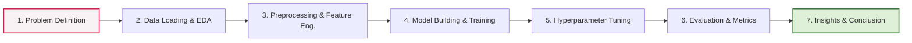

# 🚀 Machine Learning Algorithms

Welcome to my comprehensive collection of Machine Learning algorithms! This repository serves as a centralized hub for all my Kaggle Notebooks, covering everything from foundational statistical models to advanced ensemble methods and deep learning architectures. 

Whether you are a beginner looking to understand the math behind the models, or a practitioner looking for clean, reproducible code templates, you'll find it here.

---

## 🗺️ Machine Learning Algorithm Taxonomy

Below is a visual flowchart representing the machine learning algorithms covered in this repository, categorized by their learning paradigms.

```mermaid
graph TD
    A[🧠 Machine Learning Algorithms] --> B(Supervised Learning)
    A --> C(Unsupervised Learning)
    A --> D(Ensemble Methods)
    A --> E(Deep Learning)

    %% Supervised Learning
    B --> B1[📈 Regression]
    B --> B2[🎯 Classification]

    B1 --> B1a[Linear / Polynomial]
    B1 --> B1b[Ridge / Lasso / ElasticNet]
    B1 --> B1c[Support Vector Regression SVR]

    B2 --> B2a[Logistic Regression]
    B2 --> B2b[K-Nearest Neighbors KNN]
    B2 --> B2c[Support Vector Machines SVM]
    B2 --> B2d[Naive Bayes]
    B2 --> B2e[Decision Trees]

    %% Unsupervised Learning
    C --> C1[🔗 Clustering]
    C --> C2[📉 Dimensionality Reduction]

    C1 --> C1a[K-Means]
    C1 --> C1b[Hierarchical Clustering]
    C1 --> C1c[DBSCAN]

    C2 --> C2a[Principal Component Analysis PCA]
    C2 --> C2b[t-SNE / UMAP]

    %% Ensemble Methods
    D --> D1[🌲 Bagging]
    D --> D2[🚀 Boosting]

    D1 --> D1a[Random Forest]
    D2 --> D2a[AdaBoost]
    D2 --> D2b[Gradient Boosting]
    D2 --> D2c[XGBoost / LightGBM / CatBoost]

    %% Deep Learning
    E --> E1[🕸️ Artificial Neural Networks]
    E --> E2[🖼️ Convolutional Neural Networks]
    E --> E3[🔄 Recurrent Neural Networks]
```



---

## 📓 Standard Notebook Pipeline

Every notebook in this repository follows a standardized, clean pipeline to ensure reproducibility and ease of understanding. 



---

## 🛠️ Tech Stack & Tools

- **Language:** Python 3.9+
- **Core Libraries:** `pandas`, `numpy`, `scikit-learn`
- **Advanced ML:** `xgboost`, `lightgbm`, `catboost`
- **Deep Learning:** `tensorflow` / `pytorch` (depending on the notebook)
- **Visualization:** `matplotlib`, `seaborn`, `plotly`
- **Environment:** Jupyter Notebooks / Kaggle Notebooks

---

## ⚙️ How to Run Locally

While these notebooks are designed to be run directly on Kaggle, you can easily run them locally:

1. **Clone the repository:**
   ```bash
   git clone https://github.com/your-username/your-repo-name.git
   cd your-repo-name
   ```

2. **Create a virtual environment (recommended):**
   ```bash
   python -m venv venv
   source venv/bin/activate  # On Windows: venv\Scripts\activate
   ```

3. **Install dependencies:**
   ```bash
   pip install -r requirements.txt
   ```

4. **Launch Jupyter:**
   ```bash
   jupyter notebook
   ```

---

## 🤝 Contributing

This is a living repository! If you find a bug, want to optimize a model, or want to add a new algorithm, contributions are highly welcome.

1. Fork the Project
2. Create your Feature Branch (`git checkout -b feature/NewAlgorithm`)
3. Commit your Changes (`git commit -m 'Add some NewAlgorithm'`)
4. Push to the Branch (`git push origin feature/NewAlgorithm`)
5. Open a Pull Request

---

## 📬 Contact

If you have any questions or just want to connect, feel free to reach out!

- **Kaggle Profile:** [Your Kaggle Username](https://www.kaggle.com/latecoders)
- **LinkedIn:** [Your LinkedIn](https://www.linkedin.com/in/diksha-singh-9a384628a/)

***
*Happy Coding & Happy Predicting! 📈🤖*
